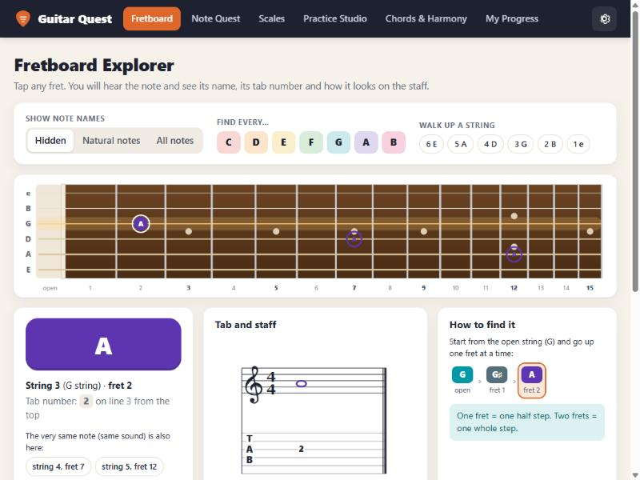
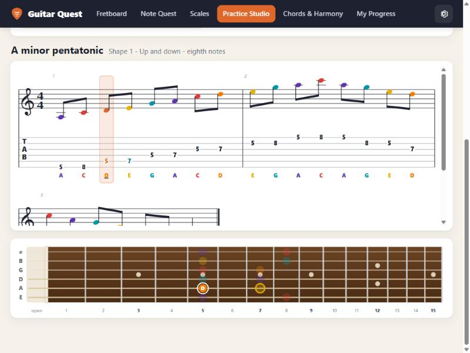
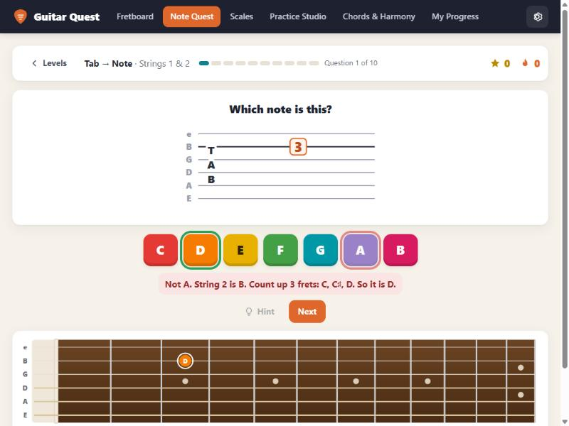
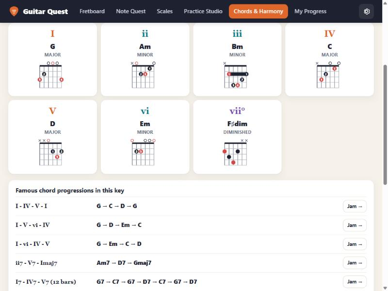

# Guitar Quest

A friendly app for learning guitar: find the notes on the fretboard, read **tab and standard notation side by
side**, practise scales with a Guitar-Pro-style player, and understand chords and harmony.
It is aimed at beginners who learn from tab, but anyone can use it.

It comes in two versions with the same features:

| | Web app (`web/`) | macOS app (`Sources/`) |
|---|---|---|
| Runs on | any modern browser — Windows, macOS, Linux | macOS 14 or later (native SwiftUI) |
| Install | nothing — open `web/index.html` | build it with Swift (see below) |
| Progress saved in | the browser's local storage | `~/Library/Application Support/GuitarQuest/progress.json` |

Both work completely offline: no account, no internet connection, no tracking. The interface is in English.



## What's inside

| Screen | What you can do |
|---|---|
| **Fretboard** | Tap any fret to hear it and see its name, its tab number and its place on the staff. A "how to find it" ladder counts the frets from the open string. Musical alphabet and a small piano view. |
| **Note Quest** | Three games — *Tab → Note*, *Staff → Fretboard* and *Note Hunt* — in 8 levels, from strings 1–2 up to the whole neck. Hints, streaks and stars; notes you often miss come back more often. Every wrong answer explains the right one. |
| **Scales** | Major, natural minor, major and minor pentatonic, and blues in all 12 keys: pentatonic shapes 1–5, open and moveable positions, 3-notes-per-string forms. Press play to hear the shape. |
| **Practice Studio** | A Guitar-Pro-like player: staff + tab, moving cursor, tempo, metronome, count-in, loop, speed trainer, and a "guitar off" switch so you can play along. Scale exercises (up/down, groups of 3 or 4, thirds; quarter notes to sixteenths) and five public-domain songs. |
| **Chords & Harmony** | Chord library (open, barre and power chords), *Build a chord* from the scale, chord families in a key (I … vii°), *Jam along* with strumming patterns, and theory games (steps, scale degrees, triads, chord families, key signatures). |
| **My Progress** | Minutes practised, day streak, accuracy, a colour map of which frets you know, and your stars. |

Settings: note names as `C D E`, `Do Re Mi` or both; sharps or flats; note colours on/off; volume.

| Practice Studio | Note Quest | Chord families |
|---|---|---|
|  |  |  |

## Getting started

### Web app (Windows or any computer)
1. Download this repository (**Code → Download ZIP**) and unzip it, or clone it.
2. Open `web/index.html` in Edge or Chrome. Click once anywhere — browsers only allow sound after a click.

Tested in Microsoft Edge / Chromium on Windows. Safari and Firefox have not been tested yet.

**Windows desktop shortcut (optional):** double-click `web/Create Desktop Shortcut.bat`. It puts a *Guitar Quest*
icon on the desktop that opens the app in its own window (no address bar), using a separate browser profile in
`%LOCALAPPDATA%\GuitarQuest\browser`. Progress made in that window and progress made in a normal browser tab are kept
separately, so use one or the other.

### macOS app
Requires macOS 14 or later and Xcode.

```bash
scripts/build.sh --product GuitarQuest        # debug build → .build/debug/GuitarQuest
swift run GoldenCheck                          # checks the Swift music engine against the web engine
scripts/build_app.sh                           # builds "build/Guitar Quest.app"
scripts/build_app.sh --install                 # …and moves it to /Applications
```

The app is signed ad hoc, so on another Mac open it the first time with right-click → **Open**.
`scripts/build.sh` passes the SwiftUI macro plugin from Xcode to the command-line-tools compiler. If you have accepted
the Xcode licence (`sudo xcodebuild -license accept`), plain `swift build` with
`DEVELOPER_DIR=/Applications/Xcode.app/Contents/Developer` works too.

Taking progress from the web app to the Mac app: see [docs/05](docs/05_DATA_AND_PROGRESS.md) (not tested yet).

## Tests
- **Web:** `node web/tests/run_tests.js` (Node 18+) — 2,717 checks: every scale, key and shape, every chord shape,
  all 20,160 practice-exercise combinations and the notation renderer.
- **macOS:** `swift run GoldenCheck` — compares the Swift engine result-for-result with output exported from the web
  engine (`Sources/GoldenCheck/Golden/*.json`). After changing the web engine, regenerate that data with
  `node web/tests/export_golden.js Sources/GoldenCheck/Golden`.

## Project layout

| Path | What it is |
|---|---|
| `web/` | The web app: plain HTML, CSS and JavaScript, no build step and no dependencies. `js/theory.js` (music rules), `js/chords.js`, `js/exercises.js`, `js/notation.js` (staff + tab drawing), `js/audio.js` (synthesised guitar), `js/views/` (one file per screen), `tests/` |
| `Sources/MusicCore` | The same music engine in Swift (no UI, no audio) |
| `Sources/GuitarQuest` | The macOS app (SwiftUI): screens, fretboard, notation, audio, saved progress |
| `Sources/GoldenCheck` | The parity checker for the Swift engine |
| `Sources/IconMaker` | Draws the macOS app icon |
| `docs/` | Specifications (features, music engine, notation, audio, data, architecture, testing) and screenshots |
| `scripts/` | macOS build scripts |

## How it works
- No sound files: the guitar is synthesised with the Karplus–Strong plucked-string method; metronome clicks are
  synthesised too.
- Staff, tab, chord diagrams and the fretboard are drawn in code (SVG on the web, SwiftUI Canvas on the Mac).
- Note spelling follows the key (for example E♯ in F♯ major, B♭ in F minor), and guitar music is written one octave
  above the sounding pitch, as in printed guitar music.

## Notes
- The songs (Mary Had a Little Lamb, Jingle Bells chorus, Ode to Joy, Twinkle Twinkle in G and in C) are public-domain
  melodies, typed in from memory — corrections are welcome.
- Chord fingerings are standard shapes; every shape is checked automatically to contain exactly the right notes.
- Issues and pull requests are welcome.

## License
[MIT](LICENSE)
